# Remote expert pay data (listed rates)

Listed hourly pay for remote expert roles on DataAnnotation, Handshake AI, Mercor, and micro1, by field, in each platform's own wording, with the source page and the date each row was last checked. Maintained by Knackboard. The same data is published at https://knackboard.com/pay-tracker.

**Listed rates as posted, not typical earnings or guaranteed income.** Each platform decides who qualifies, which projects are open, how many hours are offered, and final pay. Follow the source link for the current listing.

Last checked: October 26, 2026. The history starts October 26, 2026, so each chart has one point for now. A new point is added on the day a listed figure changes.

## Files

- `pay-tracker.csv`: one row per listing, as posted.
- `pay-tracker-history.csv`: one row per date, field, and platform, added only on the day the listed figures for that pair changed (earlier dates kept), used for the charts.
- `changelog.csv`: listed figures we saw change, dated by the day we noticed, plus rows added to the tracker (old_pay "Not tracked").
- `charts/*.svg`: one chart per field, generated from `pay-tracker-history.csv`.

## Charts: listed pay ranges, as posted

Each chart shows, for each platform in alphabetical order, the lowest and highest hourly figure it listed in that field on each date shown, and how many listings were counted. A platform appears on a later date only when its figures in that field changed that day. Platforms are not ranked.

### Accounting and Finance

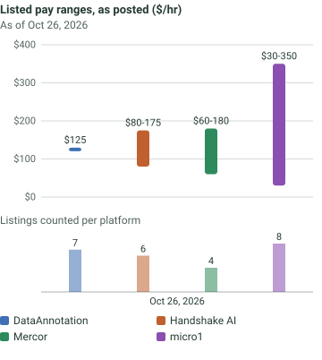

| Sweep date | Platform | Listed low ($/hr) | Listed high ($/hr) | Listings |
|---|---|---|---|---|
| 2026-10-26 | DataAnnotation | 125 | 125 | 7 |
| 2026-10-26 | Handshake AI | 80 | 175 | 6 |
| 2026-10-26 | Mercor | 60 | 180 | 4 |
| 2026-10-26 | micro1 | 30 | 350 | 8 |

### All fields (platform FAQ)

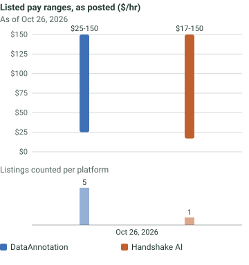

| Sweep date | Platform | Listed low ($/hr) | Listed high ($/hr) | Listings |
|---|---|---|---|---|
| 2026-10-26 | DataAnnotation | 25 | 150 | 5 |
| 2026-10-26 | Handshake AI | 17 | 150 | 1 |

### Consulting and Business

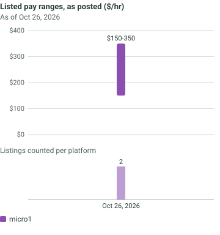

| Sweep date | Platform | Listed low ($/hr) | Listed high ($/hr) | Listings |
|---|---|---|---|---|
| 2026-10-26 | micro1 | 150 | 350 | 2 |

### Education

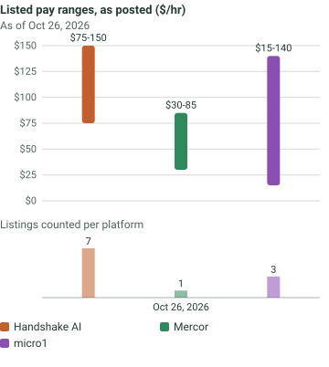

| Sweep date | Platform | Listed low ($/hr) | Listed high ($/hr) | Listings |
|---|---|---|---|---|
| 2026-10-26 | Handshake AI | 75 | 150 | 7 |
| 2026-10-26 | Mercor | 30 | 85 | 1 |
| 2026-10-26 | micro1 | 15 | 140 | 3 |

### Engineering

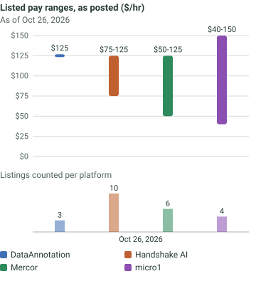

| Sweep date | Platform | Listed low ($/hr) | Listed high ($/hr) | Listings |
|---|---|---|---|---|
| 2026-10-26 | DataAnnotation | 125 | 125 | 3 |
| 2026-10-26 | Handshake AI | 75 | 125 | 10 |
| 2026-10-26 | Mercor | 50 | 125 | 6 |
| 2026-10-26 | micro1 | 40 | 150 | 4 |

### General

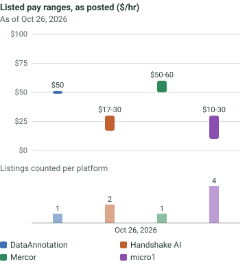

| Sweep date | Platform | Listed low ($/hr) | Listed high ($/hr) | Listings |
|---|---|---|---|---|
| 2026-10-26 | DataAnnotation | 50 | 50 | 1 |
| 2026-10-26 | Handshake AI | 17 | 30 | 2 |
| 2026-10-26 | Mercor | 40 | 70 | 1 |
| 2026-10-26 | micro1 | 10 | 30 | 4 |

### Languages

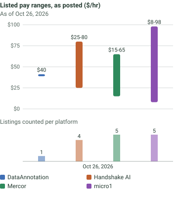

| Sweep date | Platform | Listed low ($/hr) | Listed high ($/hr) | Listings |
|---|---|---|---|---|
| 2026-10-26 | DataAnnotation | 40 | 40 | 1 |
| 2026-10-26 | Handshake AI | 25 | 80 | 4 |
| 2026-10-26 | Mercor | 15 | 65 | 5 |
| 2026-10-26 | micro1 | 8 | 98 | 5 |

### Law

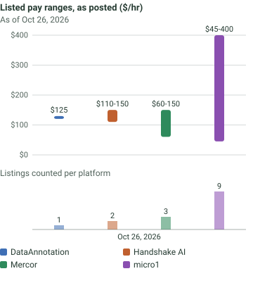

| Sweep date | Platform | Listed low ($/hr) | Listed high ($/hr) | Listings |
|---|---|---|---|---|
| 2026-10-26 | DataAnnotation | 125 | 125 | 1 |
| 2026-10-26 | Handshake AI | 110 | 150 | 2 |
| 2026-10-26 | Mercor | 60 | 150 | 3 |
| 2026-10-26 | micro1 | 45 | 400 | 9 |

### Medicine and Health

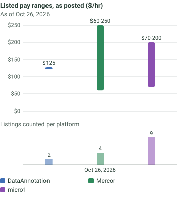

| Sweep date | Platform | Listed low ($/hr) | Listed high ($/hr) | Listings |
|---|---|---|---|---|
| 2026-10-26 | DataAnnotation | 125 | 125 | 2 |
| 2026-10-26 | Mercor | 60 | 250 | 4 |
| 2026-10-26 | micro1 | 60 | 200 | 10 |

### Pharmacy

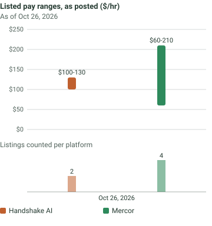

| Sweep date | Platform | Listed low ($/hr) | Listed high ($/hr) | Listings |
|---|---|---|---|---|
| 2026-10-26 | Handshake AI | 100 | 130 | 2 |
| 2026-10-26 | Mercor | 60 | 210 | 4 |

### Science and Research

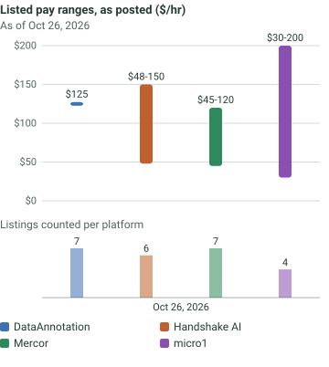

| Sweep date | Platform | Listed low ($/hr) | Listed high ($/hr) | Listings |
|---|---|---|---|---|
| 2026-10-26 | DataAnnotation | 125 | 125 | 7 |
| 2026-10-26 | Handshake AI | 48 | 150 | 6 |
| 2026-10-26 | Mercor | 45 | 120 | 7 |
| 2026-10-26 | micro1 | 30 | 200 | 4 |

### Software and Data

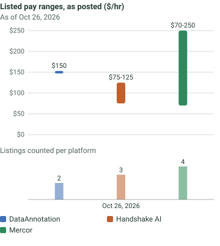

| Sweep date | Platform | Listed low ($/hr) | Listed high ($/hr) | Listings |
|---|---|---|---|---|
| 2026-10-26 | DataAnnotation | 150 | 150 | 2 |
| 2026-10-26 | Handshake AI | 75 | 125 | 3 |
| 2026-10-26 | Mercor | 70 | 250 | 4 |

## How listed pay becomes numbers

Every dollar figure in a listing counts toward both its low and its high, "up to" figures included. "Up to $125+/hr" counts as 125 for both, and "$60-$180 / hr" counts as 60 and 180. A trailing "+" is kept as the stated number. Only hourly wording is charted. For one sweep date, field, and platform, `listed_low` is the lowest figure and `listed_high` the highest figure across the rows listed that day (a row whose recheck failed keeps its last listed value).

Rows left out of the charts (still in `pay-tracker.csv`):

- Mercor, Engineering, Nuclear Engineer, Fuel Cycle: "$65-$75 / task" (per-task pay, not an hourly rate)

## Column dictionary

### pay-tracker.csv

| Column | Meaning |
|---|---|
| `platform` | Platform that posted the listing |
| `field` | Field grouping used by Knackboard |
| `role_or_listing` | Role or listing title as posted (long dashes replaced with hyphens) |
| `listed_pay` | Listed pay in the platform's own wording |
| `source_url` | Public page the figure was copied from |
| `last_checked` | Date (YYYY-MM-DD) the row was last rechecked against its source |

### pay-tracker-history.csv

| Column | Meaning |
|---|---|
| `sweep_date` | Date (YYYY-MM-DD) the change was seen |
| `field` | Field grouping |
| `platform` | Platform |
| `listed_low` | Lowest listed hourly figure, US dollars, across that platform's parsed rows in the field that day |
| `listed_high` | Highest listed hourly figure, US dollars, across the same rows |
| `listing_count` | Number of rows parsed for that sweep date, field, and platform |
| `source_note` | Which rows and source sites the figures come from, and any rows skipped |

### changelog.csv

| Column | Meaning |
|---|---|
| `date_observed` | Date (YYYY-MM-DD) we noticed the change |
| `platform`, `field`, `role_or_listing` | Which listing changed |
| `old_pay`, `new_pay` | Listed pay before and after, as posted ("No longer listed" when a role left the source) |
| `source_url` | Public page for the listing |

## Sources

- DataAnnotation: role pages on https://www.dataannotation.tech/job-board and the FAQ at https://www.dataannotation.tech/faqs
- Handshake AI: role pages under https://joinhandshake.com/ai/opportunities/ and the FAQ at https://joinhandshake.com/ai/
- Mercor: job listings on https://work.mercor.com/
- micro1: only the public listing at https://www.micro1.ai/experts/opportunities

Referral bonuses are never counted as pay.

## Disclosure

Knackboard earns referral fees from these platforms. The figures here come from each platform's own pages and are not affected by those fees.

## License

The data (the CSV files and charts) is licensed under CC BY 4.0 (https://creativecommons.org/licenses/by/4.0/). Please credit "Knackboard pay tracker, https://knackboard.com/pay-tracker".
